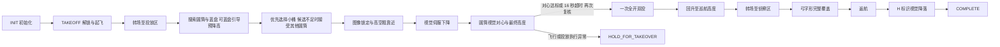

# Quick bucket 当前任务与控制流程

核对日期：2026-10-07。范围：电脑开发工作空间的 `Optimization` 与机载部署的 `jetson` 分支。

## 默认入口与圆筒视觉投放

两分支的真机 quick 脚本与任务 YAML 默认 `quick_drop_profile=bucket`；Optimization 的仿真脚本与 launch 也默认 bucket。可用 `quick_drop_profile:=blue` 切回原有蓝盘策略。jetson 分支保留的旧 SITL 启动入口未同步这些仿真参数，不能用它验证当前 bucket 策略；真机入口不受其影响。通用节点代码的 profile 默认值仍为 blue。

当前 bucket 的低空水平伺服只跟踪圆筒，不依赖蓝盘配对。正常投放原因是 `cylinder_visual`；进入最终高度后 16 秒仍未完成对心则刹车并以 `cylinder_timeout` 投放。旧 `bucket_calibration_valid` 参数留作配置兼容，已不参与选桶和投放判断。这个策略允许自动释放，不能将其日志解释为已验证的物理入桶精度。

当前舵机一次全开会同时释放前后两件物品；圆筒视觉对心以使前舱物品进入桶口为目标。新门禁不要求后舱落在蓝盘，后舱落点需另行实测；代码没有先后分舱投放两次的流程。

真机启动：

```bash
./scripts/start_quick_mission_real.sh
```

仿真启动（默认 bucket）：

```bash
./scripts/start_quick_simulation.sh
```

选择蓝盘基线：

```bash
./scripts/start_quick_mission_real.sh quick_drop_profile:=blue
./scripts/start_quick_simulation.sh quick_drop_profile:=blue
```

## 任务状态流程



1. **初始化与起飞**：等待系统和遥测就绪。FSM 的 ARM 是准备阶段，实际解锁检查在 TAKEOFF。真机 quick launch 默认等待遥控器解锁；SITL 由代码解锁。起飞前持续发送保持位置的 setpoint，确认 PX4 进入 Offboard 后爬升至 `takeoff_height=5.0 m`。
2. **投放区搜索与预降高**：转场至投放区，在 `area1_search_altitude=4.5 m`（相对起飞点）搜索。2026-10-06 根据首次实飞反馈由 5.6 m 降至 4.5 m，增大小桶像素尺寸，扫描补足视场；起飞高度仍为 5.0 m。bucket 启用圆筒与蓝盘两模型；圆筒的半径须处于 0.03–0.30 m，最近 2 s 内至少有三个不同相机帧的有效观测。若暂时没有合格圆筒，但蓝盘在 1 s 内连续三个不同采集帧可见，则仅以蓝盘像素进行引导，以真机 0.28 m/s（SITL 0.30 m/s）下降至约 3.0 m，同时继续寻找圆筒。蓝盘临近画面边缘时仅横移，蓝盘丢失立即停降；到 3.0 m 无圆筒则停降并低空扫描。目标选择优先 0.06–0.09 m 小桶，其次接受其他尺寸；搜索阶段不要求蓝盘配对或有效世界投影，也不以投放区矩形过滤 bucket 目标。只需一个稳定候选。蓝盘预降高不生成投放许可。
3. **视觉接近**：选中后按像素连续性锁定圆筒。当前帧可见时，直接由像素误差控制机体前、右速度；若短时不可见，世界坐标仅在高空提供限幅 0.5 m 的粗靠近参考，无有效坐标时悬停重捕获。连续新鲜的居中视觉帧使任务进入伺服下降；高空投影偏差不触发接近异常。
4. **连续伺服下降**：水平视觉微调与垂直下降合并到同一个机体速度指令。bucket 只用当前圆筒像素控制水平运动；蓝盘只在高空预降高时引导，不参与低空控制与投放门禁。桶径在搜索阶段帮助优先选小桶，低空不重复做桶径确认。圆筒短时丢失先悬停重捕获；超过 2 s 后保持零水平速度，以受限垂直速度降至最终高度。低于 1.9 m 将垂直速度降至 0.12 m/s，约 1.65 m 停止下降并启动 16 s 最终对心计时。
5. **投放**：放行高度窗口为起飞点相对高度 1.5–1.7 m。圆筒新鲜帧经前舱偏置补偿后，连续三个不同帧的像素误差不超过 8 px，刹车至少 0.30 s、取得刹车后新帧且速度达标，即产生 `cylinder_visual` 意图。超过 16 s 未达标则发零速度刹车，速度达标后产生 `cylinder_timeout` 意图，即使当时看不到圆筒或蓝盘。EXECUTE_DROP 复核高度、姿态、遥测与意图后只发一次舵机服务请求，将 PWM 从 1150 μs 全开到 2150 μs，同时释放两件物品。服务成功后回升至约 5 m；结果失败或不明确时请求接管。
6. **侦察与返航**：quick 的 `max_drops=1`，一次双投后转场至侦察区，以约 3 m 高度跑完整弓字形路径。当前实现切换为覆盖监控，不逐筒悬停检查危险品。完成路径后返航，搜索 H 标识，通过有效且连续的视觉观测伺服对心下降，再交接垂直下降或 PX4 LAND。舵机 ACK 与任务 COMPLETE 都不代表物品实际入桶。

## 飞行控制与视觉数据流


FSM 以 20 Hz 执行状态；视觉按自身帧率异步发布结果。一个视觉帧可被多次控制 tick 读取，但搜索候选和圆筒对心许可按相机采集时间去重。

投放微调使用圆筒图像中心误差。当前真机约定是画面右侧目标使飞机右移、画面上侧目标使飞机前移。误差先做 EMA 平滑，再按焦距和相机到桶口的距离换算为米，由比例控制产生水平速度。bucket 连续伺服的水平合速度上限随高度降低：高于 3.0 m 为 0.25 m/s，1.9–3.0 m 为 0.14 m/s，不高于 1.9 m 为 0.065 m/s；垂直指令维持真机 0.45、0.28、0.12 m/s 的原有分段。像素目标按前舱前偏 4.5 cm 做补偿，使前物品的脱离点接近桶心。圆筒丢失时不改用蓝盘控制水平速度；先悬停，超过 2 s 后仅继续受限垂直下降。分段限速的估算与验证边界见 [速度核对方案](PLAN_quick_bucket_servo_speed_20261007.md)。

`FlightController` 将前/右速度按当前航向旋转成 NED 北/东速度；PX4 桥接持续发布 setpoint 与 Offboard 心跳。代码产生航点或速度目标，底层姿态稳定和电机控制由 PX4 完成。位置转场、回升、返航主要使用位置 setpoint；投放与视觉降落主要使用速度 setpoint。

bucket 的高空世界坐标只作粗靠近参考；投影缺失或与当前图像不一致时不否决视觉目标。蓝盘预降高以当前图像和地面平面计算运动，不套用桶口高度或前舱偏置。选桶后低空圆筒候选直接按图像像素与采集时间选择，不做局部世界投影；最终许可只检查当前圆筒像素、速度、刹车、高度与遥测。超过 16 s 时视觉许可让位于任务保底投放。像素对心、舵机 ACK 都不能证明物品实际入桶；释放延迟、风、下洗和机体偏置仍需真机试投。预降高详细方案见 [蓝盘引导预降高](PLAN_quick_blue_guided_predescent_20261007.md)。

## 投放门禁与高度口径

- 位置、速度与姿态遥测须有效且最新年龄不超过 0.10 s；高度必须在 1.5–1.7 m。圆筒正常许可使用 0.25 s 内的新鲜观测，不要求蓝盘。
- 正常与超时投放都要求水平速度不超过 0.08 m/s、垂直速度绝对值不超过 0.08 m/s，并至少刹车 0.30 s。
- 正常许可要求最近 1 s 内三个不同的圆筒采集帧，前舱偏置补偿后的误差不超过 8 px，且刹车后仍有新帧。
- 最终高度开始计时 16 s；到时刹车后直接尝试投放，不再因圆筒对心超时请求接管。此路径可以没有当前圆筒或蓝盘，日志标记 `cylinder_timeout`。
- 低于 1.5 m、里程计坐标系错误、当前遥测非有限值、PX4 脱离 Offboard、舵机服务失败或结果不明确仍请求人工接管。旧 `bucket_calibration_valid` 参数不构成视觉许可的否决条件。

代码中的 1.6 m 是机体相对起飞位置的上升高度。真机量测配置为 O 点起飞时离地 0.40 m、镜头向下偏移 0.365 m、前后脱离点向下偏移 0.345 m、桶口离地 0.40 m。因此在相对高度 1.6 m 时，镜头离地约 1.635 m，物品脱离点离地约 1.655 m；相机到桶口约 1.235 m，前物品到桶口约 1.255 m。O 与 PX4 机体参考点是否一致、释放延迟和实飞散布仍需标定。

先前 SITL 已验证旧 `small_bucket` 许可、Mock 舵机与后续完整任务连通，名义真值落点残差约 1.1 cm；场景没有真实物品入桶物理仿真，不能据此认定真机命中率。证据见 [2026-09-27 SITL 报告](REPORT_quick_small_bucket_sitl_2026-09-27.md)。2026-10-07 的新圆筒视觉/16 s 超时策略尚无完整 SITL 和真机入桶实测证据。

## 本次默认模式切换的检查

2026-10-05：两个脚本通过 `bash -n`；四份 quick 任务/视觉 YAML 解析通过且 profile 均为 bucket，任务标定锁仍为 false；两个 launch Python 语法检查通过，安装空间的 `--show-args` 均显示默认 bucket；相关启动配置、脚本与投放门禁回归测试 61 项通过；`drone_vision`、`drone_mission`、`drone_bringup` 三个包构建通过。本次未重跑完整 SITL，也未执行真机飞行。
