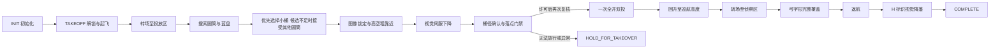

# Quick bucket 当前任务与控制流程

核对日期：2026-10-06。范围：电脑开发工作空间的 `Optimization` 与机载部署的 `jetson` 分支。

## 默认入口与标定锁

当前 quick 真机/仿真启动脚本、launch、任务与视觉 quick YAML 均默认 `quick_drop_profile=bucket`。命令行参数优先，可用 `quick_drop_profile:=blue` 返回原有蓝盘策略。通用节点代码的 profile 默认值仍为 blue，普通 full launch 使用自己的配置。

模式选择与小桶释放许可是两个独立开关。真机任务 YAML 的 `bucket_calibration_valid=false`，仿真 launch 的 `bucket_sim_calibration_valid=false`。因此默认 bucket 会执行选桶、伺服和门禁，但不会发出 `small_bucket` 许可；只可能在配对蓝盘门禁满足时以 `blue_disc_fallback` 双投，否则继续等待或请求接管。

当前双投目标是前舱物品进小桶、后舱物品落在配对蓝盘，两件同时释放；代码没有先后分舱投放两次的流程。

真机启动：

```bash
./scripts/start_quick_mission_real.sh
```

仿真名义标定精投测试（仅 SITL）：

```bash
./scripts/start_quick_simulation.sh bucket_sim_calibration_valid:=true
```

选择蓝盘基线：

```bash
./scripts/start_quick_mission_real.sh quick_drop_profile:=blue
./scripts/start_quick_simulation.sh quick_drop_profile:=blue
```

## 任务状态流程



1. **初始化与起飞**：等待系统和遥测就绪。FSM 的 ARM 是准备阶段，实际解锁检查在 TAKEOFF。真机 quick launch 默认等待遥控器解锁；SITL 由代码解锁。起飞前持续发送保持位置的 setpoint，确认 PX4 进入 Offboard 后爬升至 `takeoff_height=5.0 m`。
2. **投放区搜索**：转场至投放区，在 `area1_search_altitude=4.5 m`（相对起飞点）搜索。2026-10-06 根据首次实飞反馈由 5.6 m 降至 4.5 m，增大小桶像素尺寸，扫描补足视场；起飞高度仍为 5.0 m。bucket 启用圆筒与蓝盘两模型；圆筒的半径须处于 0.03–0.30 m，最近 2 s 内至少有三个不同相机帧的有效观测。目标选择优先 0.06–0.09 m 小桶，其次接受其他尺寸；搜索阶段不要求蓝盘配对或有效世界投影，也不以投放区矩形过滤 bucket 目标。只需一个稳定候选。
3. **视觉接近**：选中后按像素连续性锁定圆筒。当前帧可见时，直接由像素误差控制机体前、右速度；若短时不可见，世界坐标仅在高空提供限幅 0.5 m 的粗靠近参考，无有效坐标时悬停重捕获。连续新鲜的居中视觉帧使任务进入伺服下降；高空投影偏差不触发接近异常。
4. **连续伺服下降**：水平视觉微调与垂直下降合并到同一个机体速度指令。仅有当前圆筒观测也可开始对心；当前观测有重复检测时优先跟踪最接近已选目标的圆筒，最终释放复核仍要求唯一观测。到约 2.4 m 开始桶径确认与不可重置的 15 s 精投预算；在 2.2–2.5 m 使用最近 1 s 的至少五个不同采集帧确认半径处于 0.06–0.09 m，必要时短暂停降。确认后继续下降，低于 1.9 m 将垂直速度降至 0.12 m/s，约 1.65 m 停止下降并持续水平微调。
5. **投放**：放行高度窗口为起飞点相对高度 1.5–1.7 m。DESCEND 产生释放意图，EXECUTE_DROP 使用最新观测与遥测重新复核。通过后只发一次舵机服务请求，将 PWM 从 1150 μs 全开到 2150 μs，同时释放两件物品。服务成功后回升至约 5 m；结果失败或不明确时请求接管。
6. **侦察与返航**：quick 的 `max_drops=1`，一次双投后转场至侦察区，以约 3 m 高度跑完整弓字形路径。当前实现切换为覆盖监控，不逐筒悬停检查危险品。完成路径后返航，搜索 H 标识，通过有效且连续的视觉观测伺服对心下降，再交接垂直下降或 PX4 LAND。舵机 ACK 与任务 COMPLETE 都不代表物品实际入桶。

## 飞行控制与视觉数据流


FSM 以 20 Hz 执行状态；视觉按自身帧率异步发布结果。一个视觉帧可被多次控制 tick 读取，但桶径确认和释放证据按相机采集时间去重。

投放微调使用图像中心误差。当前真机约定是画面右侧目标使飞机右移、画面上侧目标使飞机前移。误差先做 EMA 平滑，再按焦距和相机到桶口的距离换算为米，由比例控制产生水平速度。bucket 连续伺服的水平合速度上限随高度降低：高于 3.0 m 为 0.25 m/s，1.9–3.0 m 为 0.14 m/s，不高于 1.9 m 为 0.065 m/s；垂直指令维持真机 0.45、0.28、0.12 m/s 的原有分段。像素目标按前舱前偏 4.5 cm 做补偿，使前物品的脱离点接近桶心。圆筒优先用于微调；仅当当前帧存在唯一且距离已选圆筒不超过 0.25 m 的蓝盘时，蓝盘才可成为投放辅助锚点。目标观测全部丢失时，水平和垂直速度归零等待重捕获。分段限速的估算与验证边界见 [速度核对方案](PLAN_quick_bucket_servo_speed_20261007.md)。

`FlightController` 将前/右速度按当前航向旋转成 NED 北/东速度；PX4 桥接持续发布 setpoint 与 Offboard 心跳。代码产生航点或速度目标，底层姿态稳定和电机控制由 PX4 完成。位置转场、回升、返航主要使用位置 setpoint；投放与视觉降落主要使用速度 setpoint。

bucket 的高空世界坐标只作粗靠近参考；投影缺失或与当前图像不一致时不否决视觉目标。低空对心用当前图像的桶口像素；投放门禁按当前图像、相机内参、镜头高度和机体位姿重算目标相对位置，再预测前后物品落点。像素居中仍不等于预计物品入桶，释放还需满足标定、速度、桶径、落点和新鲜度门禁。

## 投放门禁与高度口径

- 位置和速度遥测年龄不超过 0.10 s；圆筒帧年龄不超过 0.25 s，配对蓝盘不超过 0.40 s；姿态/航向也须有效且新鲜。
- 释放时水平速度不超过 0.08 m/s，垂直速度绝对值不超过 0.08 m/s。
- 小桶许可必须已标定并确认桶径，最近 1 s 有三个不同圆筒帧满足落点条件，刹车至少 0.30 s，且取得刹车后新帧。
- 前物品到桶口的预测残差加不确定度不得超过名义 4.5 cm；当前前舱不确定度占位值为 3 cm，对应残差余量约 1.5 cm。后物品到配对蓝盘也必须满足独立落点条件。
- 桶径失败、没有小桶标定、圆筒持续丢失或接近精投截止时，可以进入同一蓝盘的兜底门禁；前后两件物品均须预计落在蓝盘内，仍须刹车和新帧复核。缺少标定时这条兜底目前使用代码里的名义偏移与误差上界。
- 低于 1.5 m、遥测异常、超出 15 s 预算或无法确认服务结果时请求人工接管，不通过历史像素对心记录绕过最终门禁。

代码中的 1.6 m 是机体相对起飞位置的上升高度。真机量测配置为 O 点起飞时离地 0.40 m、镜头向下偏移 0.365 m、前后脱离点向下偏移 0.345 m、桶口离地 0.40 m。因此在相对高度 1.6 m 时，镜头离地约 1.635 m，物品脱离点离地约 1.655 m；相机到桶口约 1.235 m，前物品到桶口约 1.255 m。O 与 PX4 机体参考点是否一致、释放延迟和实飞散布仍需标定。

先前 SITL 已验证 small_bucket 许可、Mock 舵机与后续完整任务连通，名义真值落点残差约 1.1 cm；场景没有真实物品入桶物理仿真，不能据此认定真机命中率。证据见 [2026-09-27 SITL 报告](REPORT_quick_small_bucket_sitl_2026-09-27.md)。默认模式切换本身不代表这些标定项目已完成。

## 本次默认模式切换的检查

2026-10-05：两个脚本通过 `bash -n`；四份 quick 任务/视觉 YAML 解析通过且 profile 均为 bucket，任务标定锁仍为 false；两个 launch Python 语法检查通过，安装空间的 `--show-args` 均显示默认 bucket；相关启动配置、脚本与投放门禁回归测试 61 项通过；`drone_vision`、`drone_mission`、`drone_bringup` 三个包构建通过。本次未重跑完整 SITL，也未执行真机飞行。
